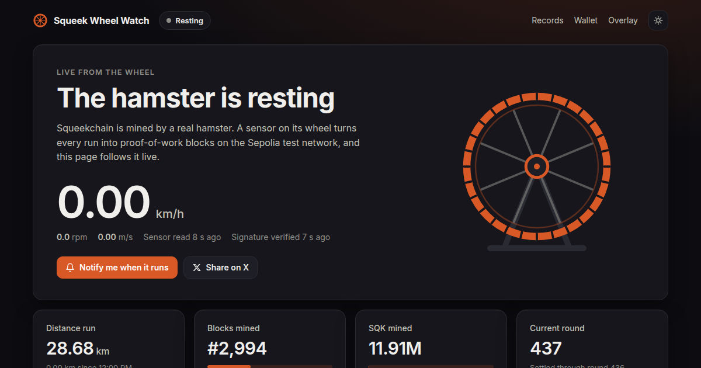

# Squeek Wheel Watch 🐹

A live dashboard for [Squeekchain](https://squeekchain.com), the proof-of-work chain powered by a real hamster wheel.

**Live at [www.squeekwheel.xyz](https://www.squeekwheel.xyz/)**



It shows, refreshed every 15 seconds:

- **The wheel**: running or resting, speed (km/h, m/s), rpm, and whether the hardware sensor is fresh
- **Total work mined** and the distance of the current run
- **Squeekchain block height** and progress into the next block
- **SQK mined** against the supply cap
- **Mining activity** over 24 hours, 7 days or 30 days: blocks, SQK minted or work, with a table view
- **Recent settlements**, linked to Sepolia Etherscan

## Run it

**Browser:** open `index.html`. It's a single file with no build step and no dependencies. You can also serve the folder with any static server, for example `python3 -m http.server`, and open http://localhost:8000.

**Terminal** (Node 18 or newer):

```bash
node cli.mjs            # print the wheel's state once
node cli.mjs --watch    # refresh every 15 seconds
```

## Data

Everything comes from Squeekchain's public read-only API. No wallet, key or login is needed.

| Endpoint | Used for |
|---|---|
| `https://api.squeekchain.com/v1/status` | wheel sensor, block height and progress |
| `https://api.squeekchain.com/v1/economy/state` | SQK supply, rounds, NFTs, staking |
| `https://api.squeekchain.com/v1/settlements?range=24h` | hourly blocks and recent settlements |

Squeekchain currently runs on the Sepolia test network, so SQK shown here is test SQK.

This is a community project and is not affiliated with the Squeekchain team.

## License

MIT
